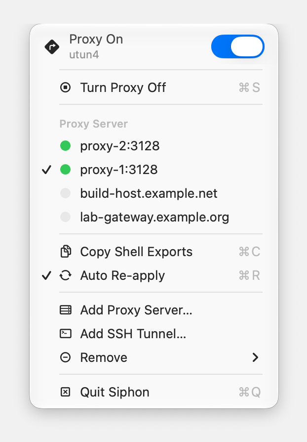

#  Siphon

A tiny native macOS menu bar app that points your traffic through an HTTP proxy —
and keeps pointing it there when the default route moves.

It replaces a shell script that had to be re-run by hand every time the network
changed underneath it.



## Features

- **Native everything**: an `NSStatusItem` with a real `NSMenu` — no Dock icon,
  no windows, no Electron. All state is read in-process through
  SystemConfiguration; the only subprocesses are the privileged writes.
- **Honest status**: the icon and header show what the system *is*, read back
  from SystemConfiguration after every write — never what the app assumed it set.
- **Follows the route**: when the default route moves — an Ethernet cable going
  in, Wi-Fi taking over, a tunnel interface coming up — the proxy is re-applied
  to whichever service now owns it. Turning the switch off clears every service
  Siphon proxied, so a stale proxy can't linger on Wi-Fi after you've moved to
  Ethernet.
- **Keeps your exception lists**: Siphon owns six keys (the HTTP and HTTPS
  enable flags, hosts, and ports) and carries the rest of each service's proxy
  dictionary through untouched — `ExceptionsList`, `ExcludeSimpleHostnames`,
  `FTPPassive`, SOCKS.
- **Steps aside when the proxy is gone**: with auto re-apply on, the selected
  proxy server is checked every 15 s and on every network change. If it stops
  answering (two failed connects in a row, three seconds apart), the proxy is
  turned off so traffic goes direct instead of failing, and the menu says
  *Paused · proxy unreachable*. When the server answers again it is turned back
  on. Turning the proxy on yourself while the server is down is respected until
  the network changes or the server comes back; turning it off is never undone.
- **Won't stomp a proxy it didn't set**: if a service already has a different
  proxy enabled, automatic re-apply stops and says so. An explicit click still
  goes through.
- **No password surprises**: automatic re-apply runs only when passwordless
  `sudo` is available. Otherwise the menu bar icon turns orange and waits for
  a click, so an admin dialog never appears unprompted.
- **Copies terminal exports** (⌘C): system proxy settings don't reach curl, git
  or pip — they read environment variables.

  ```sh
  export HTTP_PROXY=http://proxy.example.com:3128
  export HTTPS_PROXY=http://proxy.example.com:3128
  ```

  When the selected proxy is an SSH tunnel, a third line is added —
  `export ALL_PROXY=socks5h://127.0.0.1:<socks port>` — so tools that honour it
  go straight to the tunnel's SOCKS5 and resolve names at the far end.

  Note that `curl` ignores the uppercase `HTTP_PROXY` on purpose — its httpoxy
  mitigation — so plain-`http://` requests through curl are not proxied by this
  block. `HTTPS_PROXY` is honoured, as are both by most other tools.
- **SSH tunnels built in**: `ssh -N -D` to hosts from your config, kept alive,
  each behind its own local HTTP proxy you can switch the system to.
- **No hard-coded servers**: the menu lists the proxies already configured on
  this Mac, plus every one you have used or added under **Add Proxy Server…** — so
  switching away from a server does not lose it.

## Build & run

Requires macOS 13+ and the Xcode command line tools.

```bash
./make-app.sh
open build/Siphon.app
```

The bundle is ad-hoc signed. To start Siphon at login, add it in
System Settings → General → Login Items.

`make-app.sh` also restamps the binary with the SDK it was built against.
SwiftPM records the deployment target (13.0) as the linked SDK, and AppKit
reads that stamp to pick a control design, so without the restamp the menu
is drawn in the pre-Tahoe style on macOS 26 and later — a flat switch rather
than the Liquid Glass one.

## SSH tunnels

For hosts you can only reach over SSH, a tunnel can be the proxy. **Add SSH
Tunnel…** takes anything you'd type after `ssh` — a `~/.ssh/config` alias or
`user@host` — and runs

```
ssh -N -D 127.0.0.1:<socks> -o BatchMode=yes -o ExitOnForwardFailure=yes \
    -o ConnectTimeout=15 -o ServerAliveInterval=10 -o ServerAliveCountMax=3 <host>
```

`-N` runs no remote command; `-D` is client-side dynamic forwarding. **Each
tunnel is its own proxy**: it gets a SOCKS5 port (from 18081) and a loopback
HTTP proxy in front of it (from 7890), and nothing is balanced across tunnels —
the system proxy points at exactly one host at a time, so where traffic exits
is never in question. Several can be connected at once; switching is a click.

In the menu, a tunnel row *is* that proxy:

- **Click** a tunnel to point the system proxy at it (connecting it first if it
  was off). ✓ marks the one in use; the dot shows state; hover for its ports.
  Plain proxy servers carry the same dot: green when the address accepts a TCP
  connection, red when it does not, checked when the menu opens (at most every
  30 s, straight to the host, never through the proxy itself) and, for the
  selected server, continuously while auto re-apply follows it. Hover for the
  latency or the reason.
  When a tunnel is the system proxy, its SOCKS5 port is written to the system's
  SOCKS proxy setting too, so apps that prefer SOCKS skip the HTTP bridge.
- **Hold ⌥** and the rows become *Connect …* / *Disconnect …*.
- Adding and removing live in their own segment below: **Add Proxy Server…**,
  **Add SSH Tunnel…** and **Remove ▸** (added servers and tunnels; discovered
  servers come from the system and stay).
- **Copy Shell Exports** and `--exports` follow whichever proxy is selected,
  tunnel or not.

What it does for you:

- **ssh runs only while you use it.** An enabled tunnel is *dormant*: its local
  proxy listens, but no ssh process exists. The first request wakes ssh and
  waits for it (a few seconds, not a 503); after 10 minutes without traffic
  ssh is stopped and the tunnel sleeps again. Clicking a tunnel connects it at
  once. A sleeping tunnel leaves the system proxy alone and ignores network
  changes.
- **Status you can trust.** A tunnel is connected only once its SOCKS port
  accepts a connection — ssh binds it after authentication, so no output is
  parsed. Health is re-checked every 45 s; a failed tunnel retries after 8 s,
  three times, then stops until clicked or the network changes.
- **If the tunnel you're using goes down** and stays down, Siphon turns the
  system proxy off so traffic goes direct instead of failing, and turns it back
  on when that tunnel returns. Like all automatic writes, this runs only with
  passwordless sudo; otherwise the icon goes orange and waits for you.
- **Ports are yours.** Each tunnel is assigned an HTTP port (from 7890) and a
  SOCKS5 port (from 18081) when added, and keeps both for good — they end up in
  exports and in the system proxy setting, so they never move underneath you,
  even though a sleeping tunnel's SOCKS port is free at the OS level. A port
  something else has taken is reported with the holder's name; the HTTP one can
  be moved when you click the tunnel and agree.
- **No stray ssh.** Children are stopped on Quit and on SIGTERM/SIGINT/SIGHUP;
  anything a crash leaves behind is reaped at the next launch.
- **Host keys are verified** against your `known_hosts`. `BatchMode` means a
  host needing a password, 2FA or a first-time key confirmation fails fast
  with ssh's message in the tunnel's tooltip. Sign in once from a terminal.
- **The bridge binds loopback only** and speaks plain HTTP proxy: `CONNECT`
  for HTTPS, absolute-URI requests rewritten to origin-form for HTTP. Relays
  are torn down as soon as either side is gone, so idle browsers don't leave
  hundreds of dead connections behind.

The ssh handling is a native reimplementation of an earlier Python tool of
mine, tunnelmux — same flags and retry cadence, minus its load balancing and
its `StrictHostKeyChecking=no`.

`--probe` lists tunnels with their ports. To exercise a real host once:

```bash
SIPHON_LIVE_SSH=some-host swift test --filter LiveSSHTests
```

## Scripting

Siphon keeps the shell script's scriptability. These run headlessly and exit:

```bash
Siphon --exports   # shell exports:  eval "$(Siphon --exports)"
Siphon --server H[:P]   # pick a proxy server; applies at once if already on
Siphon --on        # route the current service through the selected proxy
Siphon --off       # turn it off, here and on any service Siphon proxied
Siphon --toggle    # flip whichever way the current service is set
Siphon --probe     # report what Siphon sees; changes nothing
```

`--probe` is the first thing to reach for when the menu says something
surprising — it prints the resolved service, which store its proxies live in,
every key being preserved, the servers it discovered, and whether passwordless
sudo is available.

```bash
./build/Siphon.app/Contents/MacOS/Siphon --probe
```

## Keys

While the menu is open: **⌘S** toggles the proxy, **⌘C** copies the shell
exports, **⌘R** toggles auto re-apply, **⌘Q** quits.

⌘S lives on the *Turn Proxy On/Off* row rather than the header, because AppKit
does not honour a key equivalent on a menu item that uses a custom view — and
the header needs one to host the switch. The header still toggles on a click.

## How it works

`State:/Network/Global/IPv4` names the service that owns the default route and
its interface, in one unprivileged read. Proxy settings are then read from — and
written to — whichever store that kind of service uses:

| Interface | Proxies live in | Written with |
|---|---|---|
| `utun*`, `ppp*`, `tun*`, `tap*` | `State:/Network/Service/<id>/Proxies` | `scutil` |
| everything else | `Setup:/Network/Service/<id>/Proxies` | `networksetup` |

Tunnel interfaces have no `networksetup` service, which is why they take the
dynamic store route. Both need root, so writes go through `sudo -n` when a sudoers rule
allows it and a native admin prompt otherwise. All the commands for one toggle
are issued as a single privileged task, so it asks at most once.

## Passwordless toggling

Automatic re-apply is deliberately limited to the passwordless path — a dialog
that appears while you're away from the keyboard is worse than a proxy that
waits. To grant it, add a scoped rule:

```bash
echo "$USER ALL=(root) NOPASSWD: /usr/sbin/scutil, /usr/sbin/networksetup" | sudo tee /etc/sudoers.d/siphon
```

Note what that grants: passwordless root for those two binaries, which is broad —
`scutil` can write anywhere in the dynamic store. Skip it if you'd rather type a
password per toggle; everything except unattended re-apply still works.

## Tests

```bash
swift test                        # unit tests, plus round-trips against real scutil and /bin/sh
SIPHON_ROOT_TESTS=1 swift test    # also exercises the privileged scutil write path
```

The privileged tests write to a dynamic-store key for a service ID that does not
exist and remove it afterwards, so nothing on the machine is affected. They need
passwordless sudo and are skipped without it.

## Verify

```bash
scutil <<< "show State:/Network/Global/Proxies"   # what the system is using
scutil <<< "show State:/Network/Global/IPv4"      # which service owns the route
```

## Notes

- HTTP and HTTPS only. PAC/auto-proxy URLs, SOCKS, and exception editing stay
  with `networksetup` and System Settings; Siphon owns one switch.
- Turning the proxy off clears the enable flags and leaves host and port in
  place, matching `networksetup -setwebproxystate off`.
- A proxy dictionary value containing a literal backslash can't be expressed in
  `scutil`'s command language. Siphon reports such keys rather than mangling
  them.

## App icon

`Siphon.icon` is an Icon Composer document — a single glass layer over a
gradient, which macOS 26 renders as Liquid Glass at runtime (light, dark,
clear and tinted variants included). `make-app.sh` compiles it with `actool`
into `Assets.car` plus a pre-rendered `Siphon.icns` for earlier systems; on a
machine without Xcode 26 the app simply builds without an icon.

The layer is the same SF Symbol the menu bar uses, rendered by
`Tools/render-icon-glyph.swift` with the arrow kept as a true cut-out so the
gradient shows through it.

## Notes on the screenshot

It is the app's own menu, captured live — not a mock-up. The server names are
examples: the capture runs against a throwaway defaults suite with discovery
switched off, so no hostname from the machine that took it can appear.

The capture opens the menu by clicking the status item with a synthetic mouse
event rather than by popping the menu up programmatically: under the macOS 26
design, controls in an app that is not active draw inactive (the switch is grey
when on), and only a click on the status item lets a menu bar app activate.
Siphon does the same when you open its menu, and hands activation back to the
app that had it when the menu closes. Taking the screenshot therefore needs
Accessibility access for the terminal that runs `--screenshot`.

## License

MIT
